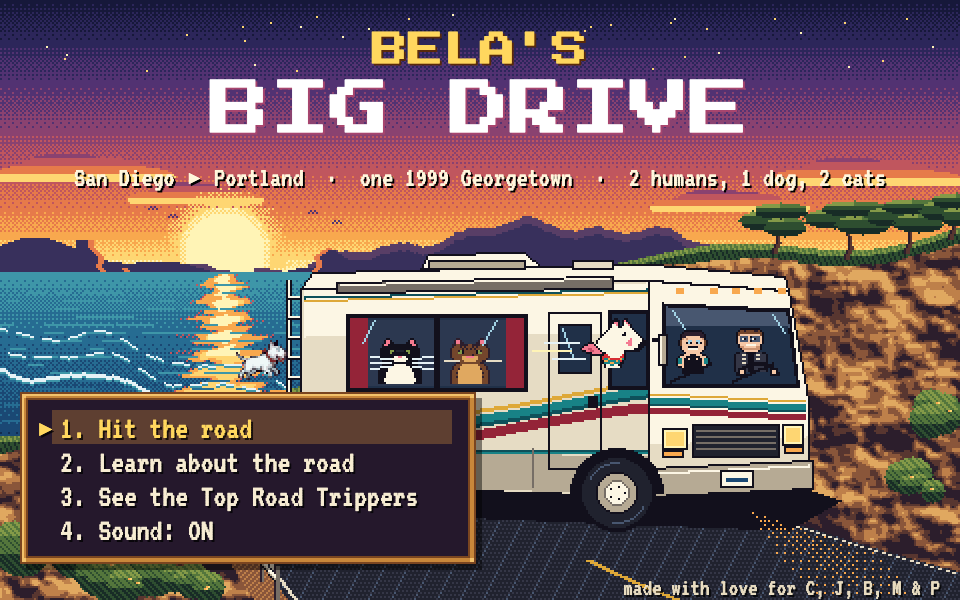
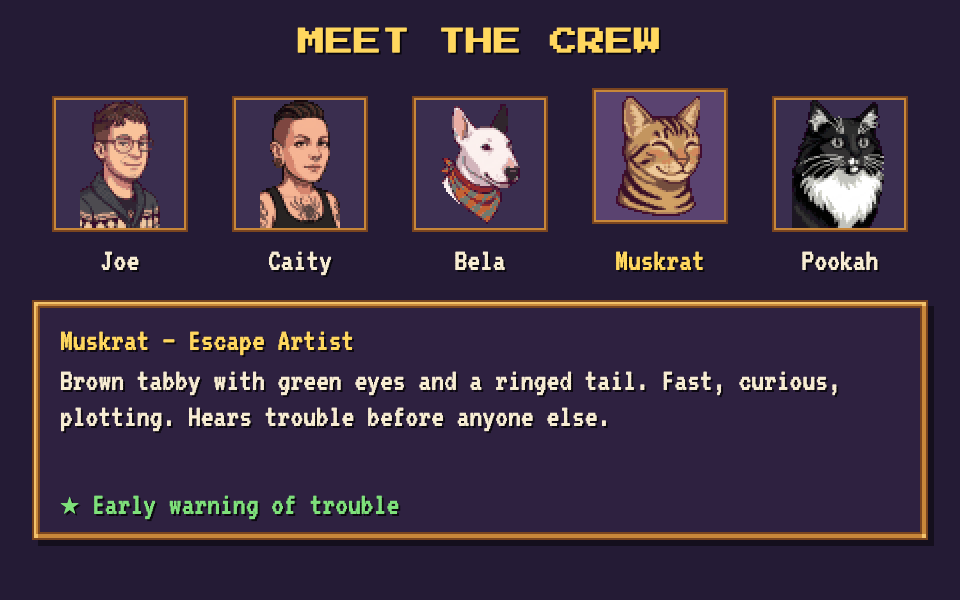
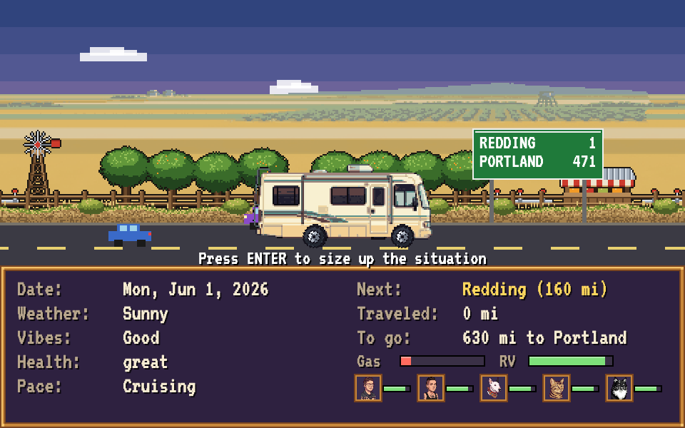
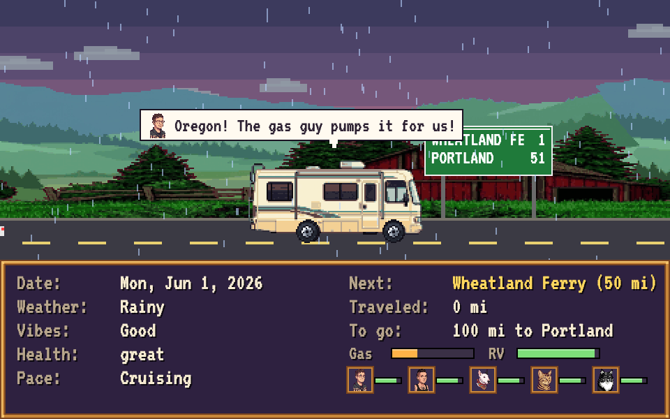

# 🚐 Bela's Big Drive

**▶ Play it: https://joemattie.github.io/bela-big-drive/**

A pixel-art road-trip survival game. Two humans, one bull terrier and two extremely unconsulted cats
drive a **1999 Forest River Georgetown** Class A motorhome from **San Diego to Portland, Oregon**.

## The crew

| | |
|---|---|
| **Joe** | Co-pilot & DJ. Glasses, cardigan, a podcast for every mile. Repairs succeed more often. |
| **Caity** | Captain of the Georgetown. Haggles like a pro and calms any animal. |
| **Bela** | Bull terrier, Head of Security. Guards the RV at night. Eats socks. |
| **Muskrat** | Brown tabby escape artist. Hears trouble before anyone else. |
| **Pookah** | Black & white floof. Purrs morale back into the crew. |

## How it plays

* **Outfit the RV** at Georgetown Outfitters: gas (the V10 drinks it at ~7 mpg), groceries, kibble,
  cat food *and* litter, spare tires, a parts kit, tire chains, propane, coffee… and toilet paper.
* **Drive ~1,100 miles** up I-5 past 29 real stops: San Onofre, LA gridlock, the Grapevine, Harris Ranch,
  Sacramento, Shasta Lake, Weed & Mt. Shasta, the Siskiyou Summit, the Oregon Vortex, Grants Pass, the
  Wolf Creek Inn, a casino in Canyonville, Eugene, the Wheatland Ferry, Oregon City… and home.
* **Two forks**: the Grapevine vs. the 101 coast (pea soup, Bubblegum Alley, Gilroy garlic, the Bay Bridge),
  and I-5 vs. US-199 through the redwoods to the Oregon coast (concrete dinosaurs! sea lions!).
* **Set your pace, food and overnights.** Floor it or mosey; farmers-market fancy or gas-station snacks;
  RV parks, big-box parking lots or boondocking under the stars.
* **85+ random events**: blowouts, the infamous V10 spark-plug ejection, crosswinds, tule fog, wildfire smoke,
  mattresses on the freeway, cat escapes, sock-eating, CHP chain checkpoints, Oregon gas attendants, Bigfoot…
* **Cross mountain passes** that close for snow (bring chains!) and **ride the Wheatland Ferry**.
* **Minigames**: Freeway Frenzy (dodge debris), Cat Wrangle (catch the escaped cat at a rest stop) and
  Blackberry Bramble (forage Oregon's most delicious weed).
* **Talk to people** at every stop for road tips, read (fake) online reviews, gamble at the slots,
  and leave a review where your trip ends for future runs to find.
* Nobody dies. If someone's health hits zero, they just fly ahead to PDX.

## Controls

Keyboard: arrows / number keys to choose, **Enter** to confirm, **Esc** to go back.
Mouse & touch: tap anything. While driving, press any key or tap to stop and size up the situation.

## Tech

Plain ES modules + a single 480×300 canvas, no build step. All music and sound effects are synthesized
live with the Web Audio API. Pixel art was generated and hand-finished specifically for this game.

Run locally: `python3 -m http.server` and open `http://localhost:8000`.

Dev helpers: `?scene=travel&leg=sacramento&weather=snow&noevents&freeze`, `?fast` (quick days),
`node tools/balance_sim.mjs 300 cel 4` (balance simulation), `tools/audio_test.html` (sound board).

---
Made with love for C, J, B, M & P.
